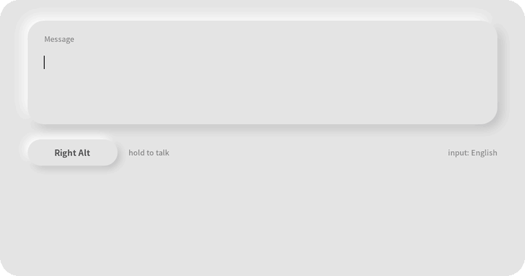
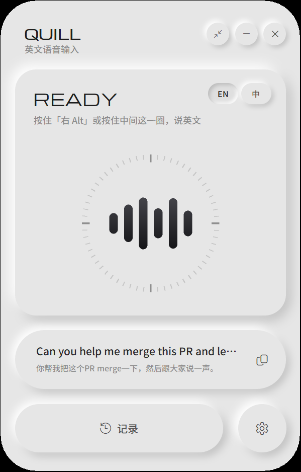
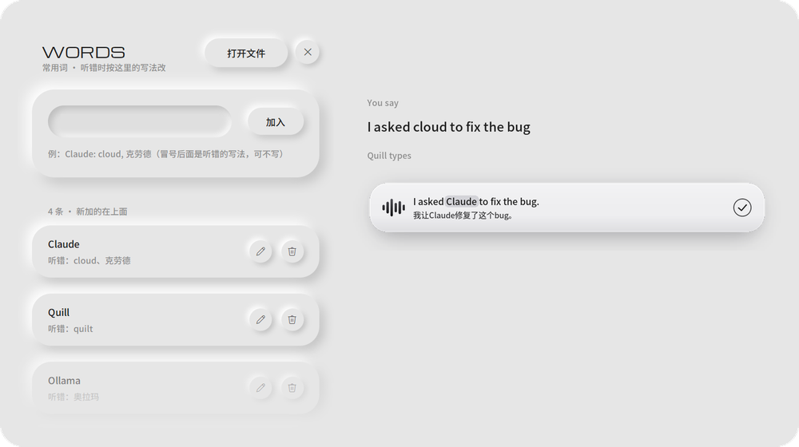

<div align="center">


# Quill

**Windows 上的离线语音输入。**
按住一个键，说不太顺的英文，**或者直接说中文**，松开后，地道的英文就打在光标处。
结巴、「嗯」「那个」、重说、改口都会去掉，常说的人名、工具名也能写对。也可以说中文出干净的中文。全程不联网。

[English](README.md) · MIT · Windows 10/11



</div>

## 为什么做它

英语不是我的母语。说英文时我会卡、会重复、会说到一半改口；很多时候用中文我知道想说什么，用英文却说不出来。
一般的听写工具要么把这些原样打出来，要么得把声音传到云端。Quill 在本机就把这些理干净：

| 你说的 | Quill 打出来的 |
|---|---|
| *I, I want to, um, I want to change the the color, no, the size of the button.* | I want to change the size of the button. |
| *Yesterday I go to the store and buy some apple.* | Yesterday I went to the store and bought some apples. |
| *嗯，我想我想把这个按钮的颜色不对，是大小改一下。* | I want to change the size of this button. |
| *帮我把这个PR merge一下，然后呃，通知一下team。* | Please merge this PR and notify the team. |

## 功能

- **在哪都能按住说话**：任何程序里按住右 Alt（可改），松开后粘贴到光标处，原来的剪贴板会恢复。
- **不只改语法**：去掉语气词、结巴、说一半放弃的话和改口（「不对，我是说……」），修正时态、冠词、单复数。
- **说中文，出英文**：主页点一下 **EN / 中** 就能切换，中英混着说也行。
- **也可以说中文、出干净的中文**：设置 →「说中文时」选「出中文」。嗯、呃、口吃、重复按规则直接删，只有带改口（不对 / 我是说……）的句子才交给大模型，大部分句子松开后约半秒出字。
- **快**：说话时，已经说完的句子就在后台先改；英文通常松开后约 0.5 秒出字（N 卡）。
- **两种输出方式**：「直接输入」，或者「让我挑选」（给自然版、口语版两种）。
- **看得到改了什么**：屏幕下方的小浮窗显示实时识别、改过的词和中文意思。
- **记得你的常用词**：主页下面的常用词表（人名、项目名、工具名）。写 `Claude: cloud`，识别出 cloud 时 Quill 看上下文判断是不是 Claude。闲着时每天扫一次记录，把可能听错的词列出来，点一下加入或忽略。
- **完全本地**：语音识别和大模型都在本机跑；记录是一个文本文件，不会离开你的电脑。
- 软 UI（新拟态）界面、悬浮小球、带一键复制的记录、内置自检。





## 原理

```
按住快捷键 → 麦克风（16 kHz）
          → 语音识别    英文：NVIDIA Parakeet TDT 0.6B v3（ONNX，CPU）
                        中文：SenseVoice Small（sherpa-onnx，CPU）
          → 理顺 / 翻译  Qwen3 8B（Ollama，有显卡用显卡，慢了自动换 CPU）
          → 粘贴到光标处
```

在一句话说完的停顿处分段，前面的句子在你还在说的时候就已经改好了。识别跑在单独的进程里，界面不会卡。

## 安装

**需要：** Windows 10/11 · 16 GB 内存 · 约 8 GB 硬盘。推荐 6 GB 以上显存的 N 卡（只用 CPU 也能跑，每句要 5~8 秒）。

```powershell
git clone https://github.com/FxrcRed/quill.git
cd quill
powershell -ExecutionPolicy Bypass -File setup.ps1 -Mirror     # 国内网络加 -Mirror，从 hf-mirror.com 下模型
```

`setup.ps1` 会装好 [uv](https://github.com/astral-sh/uv) 和 Python 3.12（不用自己装 Python）、依赖包、两个语音模型（约 0.9 GB）、
[Ollama](https://ollama.com) 和 `qwen3:8b`（约 5 GB），并在桌面建快捷方式。可以重复运行，已有的会跳过。

装好后双击桌面上的 **Quill**，等出现 **READY**，按住 **右 Alt** 说话。

## 使用小贴士

- 状态卡片右上角的 **EN / 中**：选你说哪种语言。默认输出英文；设置里「说中文时」选「出中文」，说中文就出中文。
- 设置：麦克风、快捷键（点「录制」再按任意键）、输出方式，还有一键自检。
- 右上角「两个箭头往里」的按钮：缩成屏幕边上的悬浮球，点一下回来。
- 记录：最近 20 句的原话、英文和中文意思。可以关掉不存、只留最近 7 / 30 天，或一键清空。
- **常用词**（主页最下面的卡片）：点开可以加、改、删，也可以用记事本打开 `words.txt`。一行一条：`正确写法: 听错的写法, 另一种听错的写法`（冒号后面可以不写）。
- Ollama 随 Quill 自动开、退出时一起关；不用时模型自动从显存卸掉（设置里选 2 / 10 / 30 分钟或不释放）。

## 开发

- 整个程序就一个文件：[`app.pyw`](app.pyw)（界面用 tkinter + Pillow 画）。
- `e2e_test.py [zh]`：不用麦克风的端到端测试（按实时速度喂一段 wav）。
- `fix_test.py [pick] [zh]`：改了提示词后，用真实说法对比改错效果。
- `term_test.py`：测模型能不能分清听错的名字（cloud → Claude）和普通词。
- `make_words_demo.py`：重新生成常用词演示图。
- `make_demo.py`：重新生成上面的 GIF 和截图。
- 这个项目是和 Claude Code 一起做的。

## 致谢

- NVIDIA 的 [Parakeet TDT 0.6B v3](https://huggingface.co/nvidia/parakeet-tdt-0.6b-v3)（CC-BY-4.0），[istupakov](https://huggingface.co/istupakov/parakeet-tdt-0.6b-v3-onnx) 导出的 ONNX 版，用 [onnx-asr](https://github.com/istupakov/onnx-asr) 运行
- FunAudioLLM 的 [SenseVoice](https://github.com/FunAudioLLM/SenseVoice)，用 [sherpa-onnx](https://github.com/k2-fsa/sherpa-onnx) 运行
- [Qwen3](https://github.com/QwenLM/Qwen3)（Apache-2.0），由 [Ollama](https://ollama.com) 提供服务
- 字体：[Noto Sans SC](https://github.com/notofonts/noto-cjk) 和 [Michroma](https://github.com/googlefonts/Michroma-font)（SIL OFL 1.1）

模型在安装时下载，各自遵守自己的许可证。Quill 本身是 [MIT](LICENSE) 许可。
