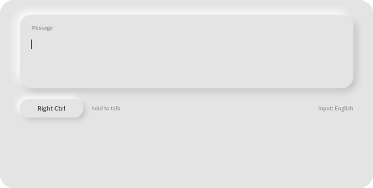
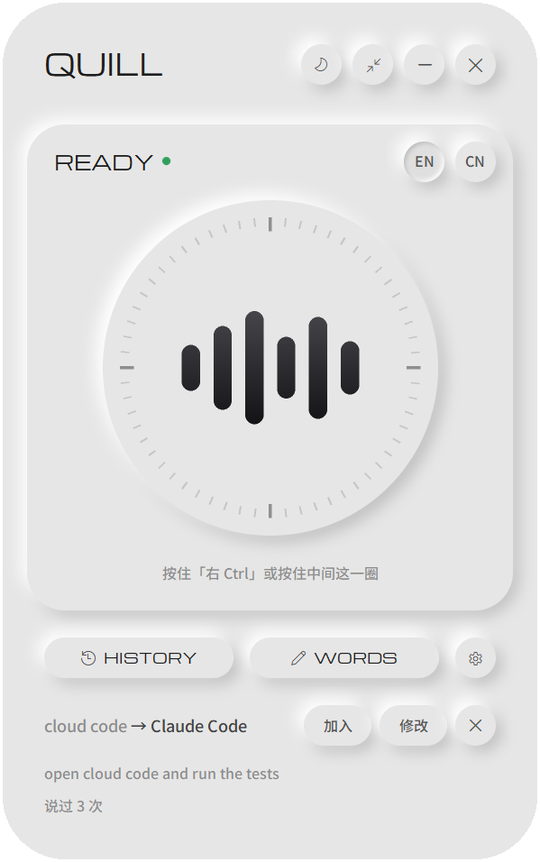
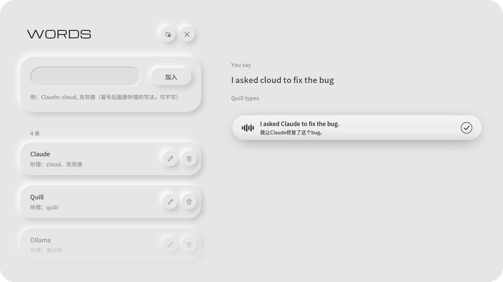

<div align="center">


# Quill

**Windows 上的离线语音输入。**
按住一个键，说不太顺的英文，**或者直接说中文**，松开后，地道的英文就打在光标处。
全程不联网。

[English](README.md) · MIT · Windows 10/11



</div>

## 为什么做它

英语不是我的母语。说英文时我会卡、会重复、会说到一半改口；很多时候用中文我知道想说什么，用英文却说不出来。
一般的听写工具要么把这些原样打出来，要么得把声音传到云端。Quill 在本机就把这些理干净：

| 你说的 | Quill 打出来的 |
|---|---|
| *I, I want to, um, I want to change the the color, no, the size of the button.* | I want to change the size of the button. |
| *Yesterday I go to the store and buy some apple.* | Yesterday I went to the store and bought some apples. |
| *嗯，我想我想把这个按钮的颜色不对，是大小改一下。* | I want to change the size of this button. |
| *帮我把这个PR merge一下，然后呃，通知一下team。* | Please merge this PR and notify the team. |

## 功能

- **在哪都能按住说话**：任何程序里按住右 Ctrl（可改），松开后粘贴到光标处，原来的剪贴板会恢复。
- **不只改语法**：去掉语气词、结巴、说一半放弃的话和改口（「不对，我是说……」），修正时态、冠词、单复数。
- **说中文，出英文**：主页选 **AUTO** 自动认出你说的是中文还是英文，不用切换；中英混着说也行。也可以出干净的中文（设置 →「说中文时」）。
- **快**：英文松开后约 1 秒出字，中文约半秒。
- **看得到改了什么**：屏幕下方的小浮窗显示实时识别、改过的词和中文意思；多显示器时它出现在你正在用的那块屏上。
- **记得你的常用词**：人名、项目名、工具名。写 `Claude: cloud`，Quill 看上下文判断 cloud 是不是 Claude。每天还会把可能听错的词列出来。

<p align="center">

&nbsp;

</p>

## 原理

```
按住快捷键 → 麦克风（16 kHz）
          → 语音识别  Whisper large-v3-turbo（显卡），带上你的常用词：
                      说话时约每秒认一遍给浮窗看，松开后整段再认一次
          → 对词表    常用词里的中文词被认成同音字的，按拼音换回来
          → 理顺      Qwen3 4B（Ollama；设置里可换 8B；显卡忙时自动换 CPU）
          → 粘贴到光标处
```

Whisper 整段认，比按停顿一段段认准得多（不会把半句话认成别的词）。识别跑在单独的进程里，界面不会卡。

## 安装

**需要**

- 仅 Windows 10/11（不支持 macOS / Linux），16 GB 内存。
- 6 GB 以上显存的 N 卡，驱动 **527.41 或更新**（CUDA 12 的要求）。Whisper 在显卡上跑，没有 CPU 模式；没有 N 卡时 `setup.ps1` 会直接报错退出。在 PowerShell 里运行 `nvidia-smi` 自查：能打出带驱动版本的表格就行。
- 安装时要联网；装 Ollama 要用 `winget`（随微软商店的「应用安装程序」App Installer 提供）。已经有 Ollama 就不需要 winget。
- 约 8 GB 硬盘：Whisper 模型 1.6 GB、`qwen3:4b` 2.6 GB、Ollama 本体约 1.5 GB、cuBLAS 0.5 GB、Python 3.12 和其他依赖包约 1 GB。可选的 `qwen3:8b` 再加 5 GB。

```powershell
git clone https://github.com/FxrcRed/quill.git
cd quill
powershell -ExecutionPolicy Bypass -File setup.ps1 -Mirror     # 国内网络加 -Mirror，从 hf-mirror.com 下模型
```

`setup.ps1` 会装好 [uv](https://github.com/astral-sh/uv) 和 Python 3.12（不用自己装 Python）、依赖包、Whisper 模型、
[Ollama](https://ollama.com) 和 `qwen3:4b`，并在桌面建快捷方式。可以重复运行。哪一步失败会用红字停下，并写明下一步怎么办（一般是：排除原因，开一个新的 PowerShell 窗口再跑一遍）。
以后缺东西，设置里的扳手图标（**准备情况**）会说缺什么，点一下就补。
想要理顺得更好，可以再 `ollama pull qwen3:8b`（约 5 GB），在设置里换。

装好后双击桌面上的 **Quill**。第一次启动要把 Whisper 模型载进显卡、并启动 Ollama，需要几秒到一分钟左右，刚开机或硬盘慢时更久。状态卡片显示 **WAKING**，直到变成 **READY**；**READY 之前按快捷键没有反应**。然后按住 **右 Ctrl** 说话。

## 使用小贴士

- 状态卡片右上角的 **AUTO / EN / CN**：AUTO（默认）每句自动认中文还是英文，EN / CN 固定一种语言。默认输出英文；设置里「说中文时」选「出中文」，说中文就出中文。
- 主页下面是 **HISTORY / WORDS** 两个按钮和设置齿轮。设置：麦克风、快捷键（点「录制」再按任意键）、输出方式、界面语言（中文或英文，默认跟随 Windows）；右上角三个圆图标分别是准备情况、自检（一键检查每个环节）和关闭。
- 右上角「两个箭头往里」的按钮：缩成屏幕边上的悬浮球，点一下回来。
- 右上角月亮 / 太阳按钮：切换深色 / 浅色。默认跟随 Windows，切回和系统一样的就恢复跟随。
- 记录（**HISTORY**）：最近 20 句的原话、英文和中文意思；标题行右边的图标可以直接打开记录文件。可以关掉不存、只留最近 7 / 30 天，或一键清空。
- **常用词**（**WORDS**）：可以加、改、删；标题行右边的图标用记事本打开 `words.txt`。一行一条：`正确写法: 听错的写法, 另一种听错的写法`（冒号后面可以不写）。
- Ollama 随 Quill 自动开、退出时一起关；不用时模型自动从显存卸掉（设置里选 2 / 10 / 30 分钟或不释放）。

## 已知问题

- 快捷键别用 Alt：在 Claude 桌面版等程序里单按 Alt 会弹出菜单、抢走焦点，导致粘贴失败。

## 开发

- 整个程序就一个文件：[`app.pyw`](app.pyw)（界面用 tkinter + Pillow 画）。
- `e2e_test.py [zh]`：不用麦克风的端到端测试（按实时速度喂一段 wav）。
- `fix_test.py [zh | zhzh]`：改了提示词后，用真实说法对比改错效果。
- `term_test.py`：测模型能不能分清听错的名字（cloud → Claude）和普通词。
- `eval_run.py [en | zh | zhzh | all]`：用固定随机种子跑改错测试集，和上一次对比。
- `cer_eval.py [auto]`：在你自己的录音（`eval_zh\`，不进 git）上算中文字错率。
- `harvest.py`：把每句识别和你在 Claude Code 里改完发出去的消息配对，自动收测试样本（要在 `settings.json` 里开 `"save_audio": true`）。
- `make_words_demo.py`：重新生成常用词演示图。
- `make_demo.py`：重新生成上面的 GIF 和截图。
- `tools/`：开发用的一次性小工具（窗口截图、界面布局测试、常用词和模型对比脚本、图标和分享预览图生成）。用 Quill 不需要管它们。`selftest.bat` 和 `start.bat` 是调试用启动器（自检；带黑框启动看报错），平时用桌面快捷方式或 `start.vbs`。
- 这个项目是和 Claude Code 一起做的。

## 致谢

- OpenAI 的 [Whisper large-v3-turbo](https://huggingface.co/openai/whisper-large-v3-turbo)（MIT），用 [faster-whisper](https://github.com/SYSTRAN/faster-whisper) 运行
- [Qwen3](https://github.com/QwenLM/Qwen3)（Apache-2.0），由 [Ollama](https://ollama.com) 提供服务
- [pypinyin](https://github.com/mozillazg/python-pinyin)（MIT）；按拼音对词表的思路来自 [CapsWriter-Offline](https://github.com/HaujetZhao/CapsWriter-Offline)
- 字体：[Noto Sans SC](https://github.com/notofonts/noto-cjk) 和 [Michroma](https://github.com/googlefonts/Michroma-font)（SIL OFL 1.1）

模型在安装时下载，各自遵守自己的许可证。Quill 本身是 [MIT](LICENSE) 许可。
